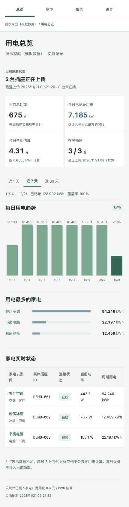
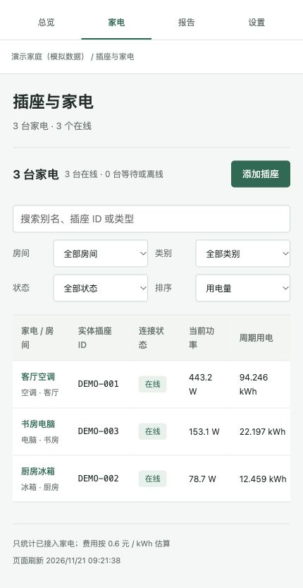
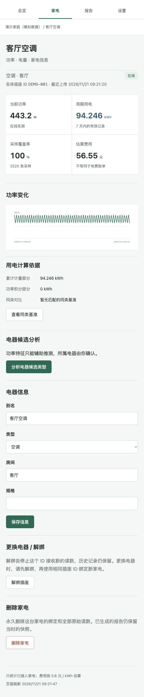
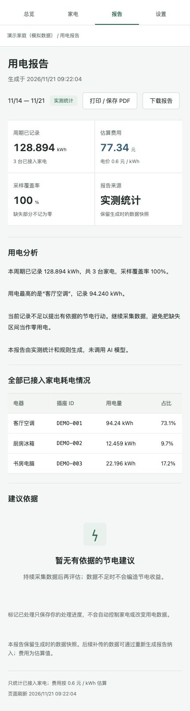

# WattGuard · 家庭用电管理

WattGuard 是一个借助 AI 辅助开发的家庭用电管理网站，帮助用户查看家电耗电情况、追踪历史用电记录，并了解家庭能源使用情况。

项目源于 **Hong Kong AI Summit: BUILD ACROSS Hackathon**，并在活动后持续完善。

## 主要功能

- **账户与家庭设置**：注册、登录，设置家庭名称、电价和时区。
- **家电管理**：通过插座 ID 绑定家电，记录电器类型、房间与名称，支持编辑和解绑。
- **用电看板**：查看功率、用电量及估算电费，自动更新数据。
- **历史记录与报告**：查询历史用电数据，生成统计报告并导出记录。
- **硬件数据接入**：通过 HTTP 接口接收插座上传的功率与累计电量数据。
- **节电分析演示**：根据已记录的数据生成分析报告与节电建议。

> 当前分析报告采用内置演示规则，不调用外部 AI 模型；会员订阅为演示流程，不收取费用。用电数据需由设备上传，不会自动生成真实家庭读数。

## 技术实现

前端使用 HTML、CSS 和 JavaScript，后端使用 Node.js，数据存储使用 SQLite。

## 功能展示

以下截图来自本地演示账户，使用模拟用电数据，仅用于展示界面与功能，不代表真实设备测量结果。

### 用电总览
查看家庭功率、周期用电量、估算费用与每日趋势。

### 家电管理
按房间、类别与连接状态筛选家电，查看各设备的用电情况。

### 家电详情
查看功率变化、用电计算依据，并管理家电信息。

### 统计报告
汇总周期用电量、费用估算与各家电耗电占比。

